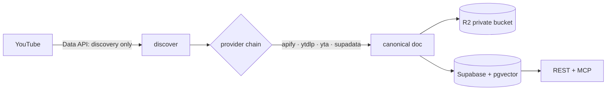

<div align="center">

<p align="center">
  
</p>

### TURN YOUTUBE INTO YOUR KNOWLEDGE BASE

*Point Minuta at the channels you learn from. It keeps every word,
timestamped — so you or any AI agent can answer from them, write like them,
think with them.*

[Quickstart](#-quickstart) · [Docs](docs/ARCHITECTURE.md) · [Keys](docs/KEYS.md) · [Operations](docs/OPERATIONS.md) · [llms.txt](llms.txt) · [AGENTS.md](AGENTS.md)


</div>

---

> **Minuta** *(n.) — the written minutes of a proceeding. The raw material
> is the record; the product is what you make with it.*

## ● What you make with it

- **Answers from voices you trust** — ask across 200 videos at once; every
  claim comes back cited with video, timestamp, and link. No generic AI slop.
- **Drafts in their voice** — scripts, posts, newsletters, ghostwriting,
  grounded in what was actually said, phrased the way it was said.
- **A thinking partner** — refer back for ideas, check what was argued where,
  build on lines of thought instead of rewatching.
- **A library that compounds** — new uploads sync automatically; the base only
  gets more useful.

Point Minuta at a channel. It discovers every upload, extracts timestamped
transcripts through a resilient provider chain, stores canonical JSON +
Markdown privately, embeds every chunk, and serves it all over REST and
remote MCP — so you, or any AI agent, can search 200 videos as easily as one.



## ● Why it holds up

| Problem | What Minuta does |
|---|---|
| YouTube transcripts are scattered, rate-limited, IP-blocked | Ordered provider chain with honest error taxonomy — definitive answers stick, transient ones back off with cooldowns, never mislabeled |
| Timestamps get destroyed by exporters | Canonical format preserves millisecond timing end-to-end; untimed sources stay honestly untimed |
| Agents hallucinate video claims | Every passage carries video ID + `?t=` link + exact `[HH:MM:SS]`; citations are structural, not stylistic |
| Re-fetching duplicates everything | Content-hash identity: identical text always resolves to one version, one chunk set |

## ● Quickstart

**You bring:** Supabase Postgres, Cloudflare R2 bucket, YouTube Data API key,
one transcript route (Apify token *or* nothing for the free paths).
Full key guide: [docs/KEYS.md](docs/KEYS.md).

```bash
git clone https://github.com/AdarshJ173/minuta && cd minuta
bash scripts/setup.sh            # venv + deps, never overwrites .env
# fill .env  (DATABASE_URL, R2_*, YOUTUBE_API_KEY, ADMIN_BOOTSTRAP_TOKEN, + provider)
PYTHONPATH=src python -m minuta.migrate
PYTHONPATH=src pytest -q         # offline suite, no network, no keys

# add a channel, backfill it, search it
TOKEN=<bootstrap>
curl -X POST $PUBLIC_BASE_URL/admin/channels -H "Authorization: Bearer $TOKEN" \
  -d '{"input":"@somehandle"}'
PYTHONPATH=src python scripts/backfill.py --max 200 --sleep 15
curl "$PUBLIC_BASE_URL/v1/search?q=your+question" -H "Authorization: Bearer $READER_KEY"
```

**Deploy** — Modal (API + 5-min worker + one-shot backfill) or any Docker host.
See [docs/OPERATIONS.md](docs/OPERATIONS.md). Typical full-channel cost: **~$0.11**.

## ● Transcript providers

First configured success wins (`TRANSCRIPT_PROVIDER_ORDER`).

| Provider | Key needed | Notes |
|---|---|---|
| `apify` | `APIFY_API_TOKEN` (free $5/mo, no card) | Store actor, timestamped JSON, ~$0.70/1k. The reliable one. |
| `ytdlp` | none | Subtitle-only VTT, manual-first. Often HTTP 429 from cloud IPs. |
| `yta` | none | `youtube-transcript-api`. Frequently IP-blocked from datacenters. |
| `supadata` | `SUPADATA_API_KEY` (100 free credits/mo) | Paid API fallback. |

Only definitive per-video outcomes are permanent (`TranscriptNotFound`,
removed, age-restricted). Inconclusive results retry; a blocked *fallback*
never triggers a global cooldown when the primary already answered.
Rules: [AGENTS.md](AGENTS.md) · logic: `src/minuta/transcripts/pipeline.py`.

## ● For agents

Point any MCP-capable agent at `$PUBLIC_BASE_URL/mcp` (Streamable HTTP,
Bearer token) or hand it this paragraph with your question appended —
template in [docs/AGENTS_PROMPT.md](docs/AGENTS_PROMPT.md). Machine-readable
surface: [llms.txt](llms.txt). Repo rules agents must obey: [AGENTS.md](AGENTS.md).

## ● Layout

```
minuta/
├── src/minuta/            # all code
│   ├── transcripts/       # providers (apify, ytdlp, remote) + pipeline chain
│   ├── api.py mcp.py worker.py ingest.py search.py index.py
│   └── settings.py db.py store.py auth.py jobs.py provider_state.py
├── migrations/            # Postgres + pgvector + FTS schema
├── scripts/               # setup.sh backfill.py make_secret.sh
├── tests/                 # offline only — MockTransport, no network
├── docs/                  # ARCHITECTURE KEYS OPERATIONS AGENTS_PROMPT
├── llms.txt AGENTS.md modal_app.py Dockerfile
```

## ● Contributing & security

PRs welcome: keep commits small, `ruff` + `pytest` green, tests stay offline.
See [CONTRIBUTING.md](CONTRIBUTING.md). To report a vulnerability, see
[SECURITY.md](SECURITY.md) — please don't open public issues for secrets or
auth bypasses.
